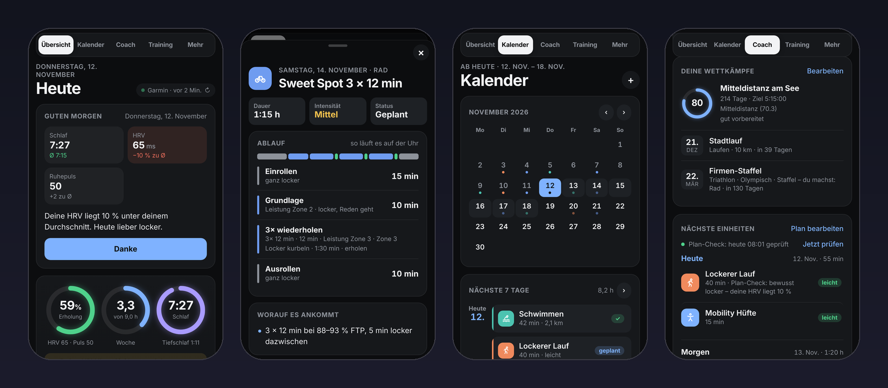
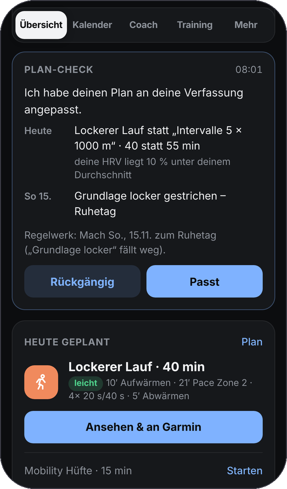
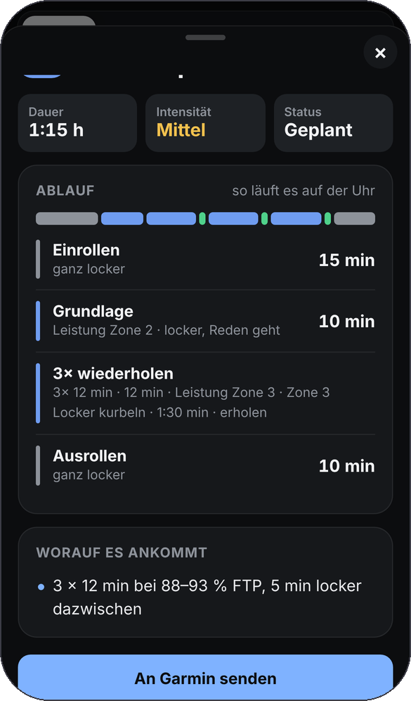
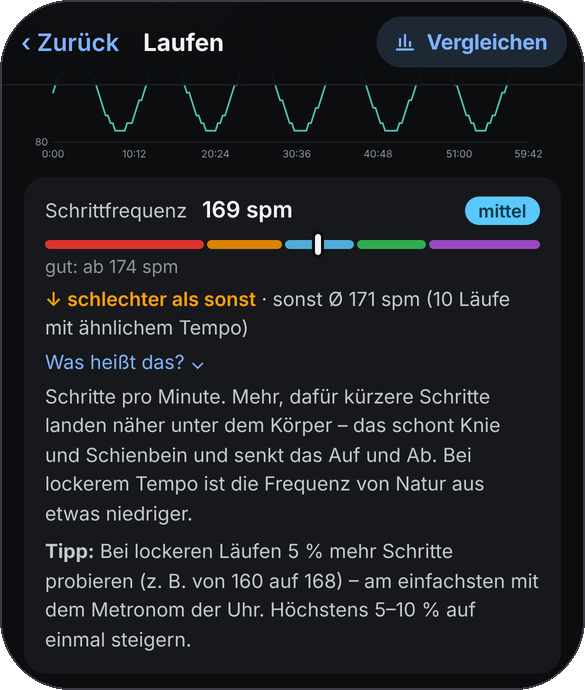
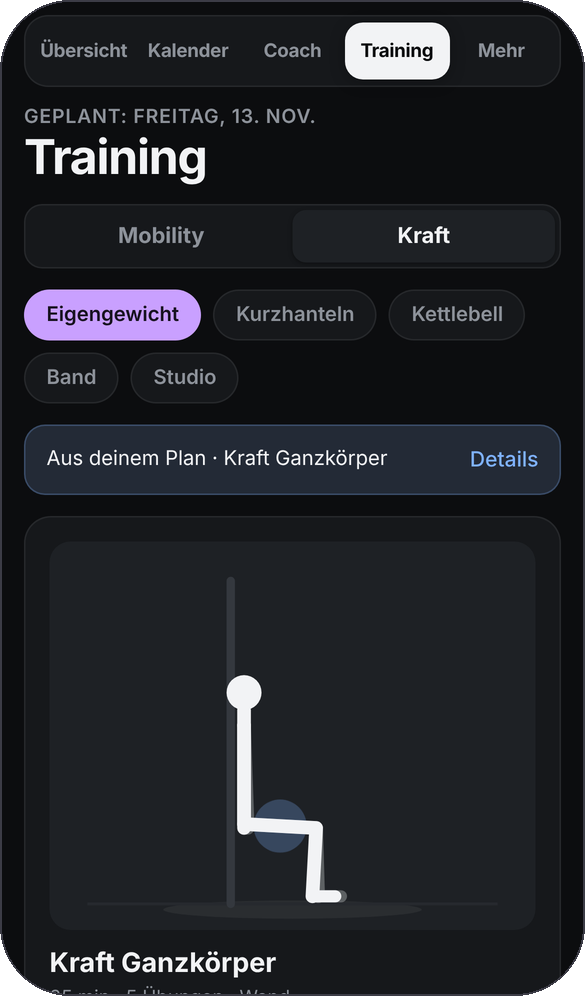
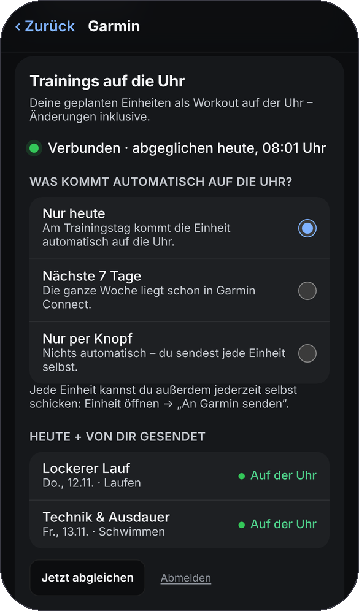
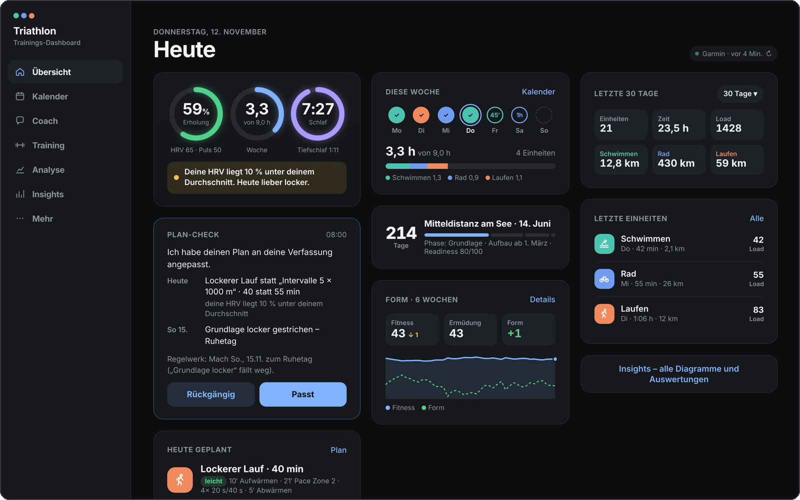
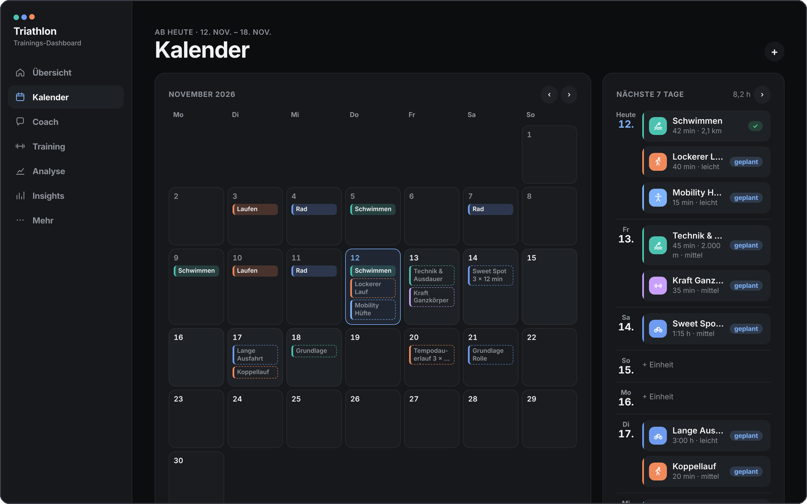
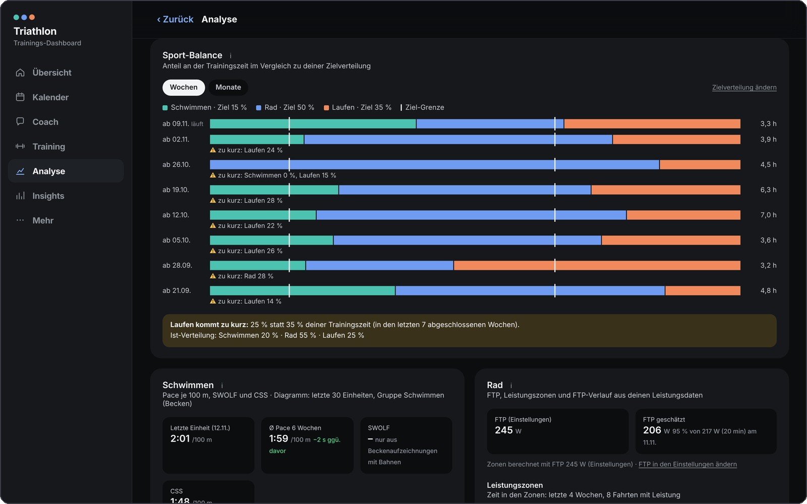
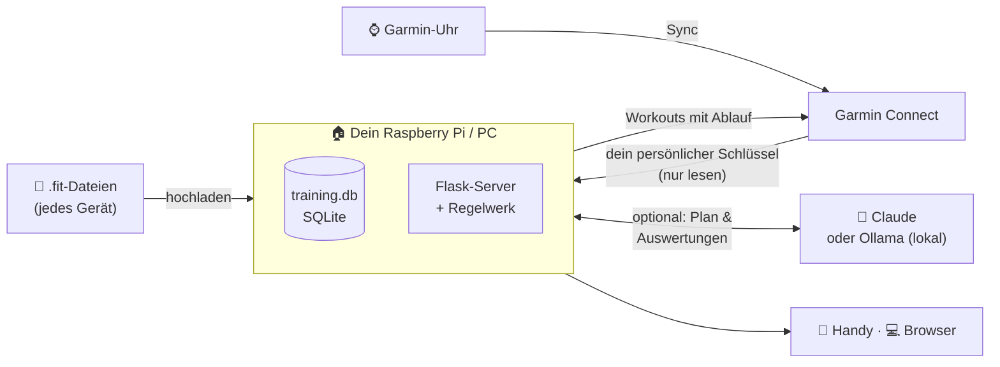

<div align="center">

# 🏊 🚴 🏃 Triathlon Trainings-Dashboard

**Dein eigener KI-Triathlon-Coach mit Trainingstagebuch und Garmin-Workout-Planer, selbst gehostet und kostenlos.**

Es kann, wofür man sonst TrainingPeaks, TriDot oder Garmin Connect+ bezahlt, aber ohne Abo,<br>
und deine Gesundheitsdaten bleiben auf deinem eigenen Gerät.

[](https://github.com/nico-lehr/TriathlonTrainingsDashboard/releases)


[](https://github.com/nico-lehr/TriathlonTrainingsDashboard/stargazers)

[English](README.md) · **Deutsch**



</div>

---

## 💸 Warum es dieses Projekt gibt

Wer ambitioniert Triathlon macht, zahlt meist für **mehrere Abos gleichzeitig**:

| Was du brauchst | Typisches Bezahl-Produkt | Listenpreis* |
|---|---|---|
| Trainingstagebuch & Auswertungen (Fitness / Ermüdung / Form) | TrainingPeaks Premium | 134,99 $ / Jahr |
| Trainingsplan per KI, der sich anpasst | Athletica · Humango · TriDot | 189 $ / Jahr · ca. 29 $ / Monat · Stufen ab 14,99 $ |
| Mehr Auswertungen der Uhr | Garmin Connect+ | 89,99 € / Jahr |
| Soziales Netzwerk / Segmente (optional) | Strava | 79,99 $ / Jahr |
| **Eine übliche Kombination** (TrainingPeaks + Athletica + Connect+) | | **rund 400 $ jedes Jahr** |
| **Dieses Projekt** | **offener Code, läuft bei dir** | **0 €** |

<sub>* Listenpreise der Anbieter bzw. ihrer App-Store-Einträge, Stand November 2026 (US-Preise in Dollar, Garmin in Euro). Preise ändern sich, Steuern sind je nach Land verschieden. Alle Produktnamen sind Marken ihrer Inhaber; dieses Projekt hat mit keinem davon etwas zu tun.</sub>

**Was optional an laufenden Kosten anfällt:**

- **KI-Coach:** Du zahlst nur, was du nutzt, mit deinem eigenen Claude-Schlüssel. Meist sind das ein paar Cent pro Anfrage, und die App zeigt dir die genauen Kosten je Modell und Aufgabe. Mit [Ollama](https://ollama.com) läuft die KI **kostenlos** auf deinem eigenen Rechner.
- **Gerät:** ein Raspberry Pi (einmalige Anschaffung), wenn das Dashboard rund um die Uhr laufen soll. Ein normaler Mac oder Windows-PC geht auch.

---

## ✨ Was du bekommst

<table>
<tr>
<td width="50%" valign="top">

### 🤖 Ein KI-Coach, der wirklich mitdenkt
- **Erstellt deinen ganzen Plan** aus Wettkampf, Trainingstagen, Schwimmtagen, Tag für die lange Einheit, Wochenstunden und Kraft-Wünschen.
- **Täglicher Plan-Check:** Er prüft jeden Tag heute und morgen, alle 3 Tage den Rest der Woche und einmal pro Woche die Zeit danach. Nach einer schlechten Nacht (niedrige HRV, hoher Ruhepuls, erhöhte Hauttemperatur) **macht er aus einer harten Einheit eine lockere** und sagt dir, warum. Mit einem Tipp kannst du das rückgängig machen.
- **„Sag dem Coach Bescheid“:** Schreib z. B. *„Heute spontan 45 min schwimmen“*, und er plant die nächsten 7 Tage um.
- **7 feste Trainingsregeln** prüfen jeden Plan, ob von der KI oder von dir: nie zwei harte Tage hintereinander, etwa 80 % locker, höchstens +10 % Umfang pro Woche, Entlastungswochen, ein Ruhetag, locker nach dem Wettkampf und mehr.

</td>
<td width="50%" valign="top" align="center">

</td>
</tr>
<tr>
<td width="50%" valign="top" align="center">

</td>
<td width="50%" valign="top">

### ⌚ Workouts direkt auf deine Garmin-Uhr
- Jede geplante Einheit wird ein **Garmin-Workout mit Ablauf**: Aufwärmen, Intervalle mit Wiederholungen und Pausen, Ausklang, und Zielbereiche aus *deinen* Pace-, Watt- und Pulswerten.
- **Schwimmen in Metern** wie beim Garmin Coach: Technikbahnen, 10 × 100 m mit 20 s Pause, Schwimmstil, Beckenlänge.
- **Auch Kraft und Mobility**, mit Übungen, Sätzen, Wiederholungen und Gewicht.
- Du bestimmst, was auf die Uhr kommt: **nur die Einheit von heute** (Standard), **die nächsten 7 Tage** oder **nur per Knopf „An Garmin senden“**. Verschiebst, änderst oder löschst du etwas, zieht Garmin von selbst mit.

</td>
</tr>
<tr>
<td width="50%" valign="top">

### 📊 „Ist mein Wert gut?“ bei jeder Einheit
- Schrittfrequenz, Bodenkontaktzeit, vertikales Verhältnis, Leistung, Puls, Tempo, SWOLF, CSS und mehr. Jeder Wert bekommt einen **Farbbalken**, einen Vergleich **besser oder schlechter als sonst** (mit deinen Läufen in ähnlichem Tempo) und eine verständliche Erklärung **„Was heißt das?“ mit Tipp**.
- **Fitness / Ermüdung / Form** (CTL/ATL/TSB), Belastungsverhältnis (ACWR), Verteilung locker/hart, Pulszonen, Bestleistungen, FTP- und CSS-Schätzung, VO2max für Laufen und Rad.
- **KI-Auswertung** einzelner Einheiten. Sie weiß, was an dem Tag geplant war und wie du geschlafen hast.

</td>
<td width="50%" valign="top" align="center">

</td>
</tr>
<tr>
<td width="50%" valign="top" align="center">

</td>
<td width="50%" valign="top">

### 🏋️ Kraft & Mobility gleich dabei
- **50 Kraftübungen** und **33 Mobility-Übungen**, jede mit bewegter Strichfigur, einfachen Schritten, typischen Fehlern und leichterer bzw. schwererer Variante.
- **Mitmach-Modus fürs Handy:** großer Timer, Seitenwechsel, „Satz geschafft“, und der Bildschirm bleibt an.
- Eigengewicht, Kurzhanteln, Kettlebell, Band oder Studio: Der Plan nimmt, was du hast, und merkt sich deine Gewichte.

</td>
</tr>
<tr>
<td width="50%" valign="top">

### 🏁 Wettkämpfe, Erholung & Alltag
- **Wettkämpfe im Detail:** Vorlagen von Supersprint bis Langdistanz und von 5 km bis Ultra, **Staffeln** (du fährst Rad, das Team macht den Rest), Streckenart, Zielzeit je Teilstrecke, dazu ein Rennplan mit Tempo und Checklisten.
- **Garmin-Events** aus deinem Garmin-Kalender erscheinen von selbst als Ziele.
- **Morgenbericht** mit Schlaf, HRV und Ruhepuls im Vergleich zu *deinem* Normalwert, auch als Mitteilung aufs Handy.
- Wetter an Outdoor-Einheiten, Kalender-Abo für Apple/Google-Kalender und Material mit Kilometerstand (Schuhe, Rad).

</td>
<td width="50%" valign="top" align="center">

</td>
</tr>
</table>

<details>
<summary><b>🖥️ Am Computer sieht es so aus</b> (zum Aufklappen antippen)</summary>
<br>



</details>

---

## ⚖️ Im direkten Vergleich

|  | Bezahl-Apps in der Cloud | **Triathlon Trainings-Dashboard** |
|---|:---:|:---:|
| Kosten pro Jahr | 70–400+ $ | **0 €** |
| Wo deine Gesundheitsdaten liegen | Server des Anbieters | **Dein eigener Pi / PC** (eine SQLite-Datei) |
| Kann abgeschaltet, eingeschränkt oder teurer werden | Ja | **Nein**, der Code gehört dir |
| KI-Coach plant nach schlechtem Schlaf um | Teilweise, in teuren Stufen | ✅ |
| Workouts mit Ablauf auf der Garmin-Uhr | Meistens | ✅ auch Schwimmen, Kraft & Mobility |
| Erklärt, *warum* ein Wert gut oder schlecht ist | Selten | ✅ bei allen wichtigen Werten |
| Freunde & Familie in einer Installation | Meist je ein eigenes Abo | ✅ per Einladung, jede Person sieht nur ihre Daten |
| KI frei wählbar (Cloud oder 100 % lokal) | Nein | ✅ Claude oder Ollama |
| Am Handy wie eine App | Ja | ✅ auf den Home-Bildschirm legen, mit Mitteilungen |

---

## 🧭 So funktioniert es



- **Ein kleiner Server bei dir zu Hause** liefert die App an alle deine Geräte. Über [Tailscale](https://tailscale.com) oder mit einem Befehl bekommst du eine feste https-Adresse.
- **Alles Persönliche liegt in einer SQLite-Datei** auf deinem Gerät. Vor jedem Start und jedem Update wird automatisch eine Sicherung angelegt.
- **Updates mit einem Klick** im Dashboard, oder ganz automatisch in der Nacht.

---

## 🚀 Loslegen

**Möglichkeit 1: erst mal nur ansehen (ohne Installation).**

```bash
python3 build-demo.py      # erstellt dashboard-demo.html mit erfundenen Beispieldaten
```
`dashboard-demo.html` per Doppelklick öffnen, fertig.

**Möglichkeit 2: auf deinem Mac oder PC (etwa 10 Minuten, ohne Vorkenntnisse).**

```bash
git clone https://github.com/nico-lehr/TriathlonTrainingsDashboard.git
cd TriathlonTrainingsDashboard
bash start.sh                        # Windows: start.bat doppelklicken
python3 backend/create_user.py       # in einem zweiten Fenster: dein Konto anlegen
```
**http://localhost:5000** öffnen, anmelden und im Onboarding Garmin verbinden. Das sind drei Schritte, und dein **Garmin-Passwort brauchst du nicht**.

**Möglichkeit 3: rund um die Uhr auf einem Raspberry Pi (empfohlen).**

```bash
bash deploy/raspberry-pi/install.sh      # installiert das Dashboard und startet es als Dienst
bash deploy/raspberry-pi/oeffentlich.sh  # optional: feste https-Adresse von überall
```

📖 Ausführliche Anleitungen Schritt für Schritt, für Einsteiger geschrieben:
[Installation](docs/INSTALLATION.md) · [Raspberry Pi](docs/RASPBERRY_PI_ANLEITUNG.md) · [Betrieb & Freunde](docs/DEPLOYMENT.md) · [Garmin-Abgleich](docs/GARMIN_SYNC_GUIDE.md)

---

## 🔒 Datenschutz & Sicherheit

- **Bewusst selbst gehostet:** kein Konto bei uns, kein Tracking, keine Werbung. Deine Daten liegen in `training.db` auf deinem Gerät.
- **Dein Garmin-Passwort wird nie gespeichert.** Die Daten kommen über Garmins offiziellen *Personal-API*-Schlüssel, der nur lesen kann. Zugangsdaten liegen außerhalb des Projektordners und sind nur für deinen Benutzer lesbar.
- **Mehrere Personen, sauber getrennt:** Jede Anfrage prüft die Anmeldung und zeigt nur die eigenen Daten. Nach zu vielen Fehlversuchen wird das Konto gesperrt, und Schutz-Kopfzeilen sind gesetzt.
- **Der Server liefert nur eine feste Liste von App-Dateien aus.** Datenbank, Schlüssel, Sicherungen und Dokumentation sind nie abrufbar.
- **Du wählst die KI:** Mit Claude gehen nur zusammengefasste Kennzahlen und dein Trainingsprofil raus, und der Schlüssel bleibt auf deinem Server, nie im Browser. Mit Ollama verlässt nichts dein Netz.

---

## 🛠️ Technik

- **Oberfläche:** reines JavaScript, HTML und CSS, ohne Framework und ohne Build-Schritt. Der **FIT-Parser** ist selbst geschrieben (inklusive komprimierter Zeitstempel und Developer-Feldern).
- **Server:** Python 3 mit Flask, SQLAlchemy, SQLite und waitress. Er läuft auch auf einem Raspberry Pi.
- **Sportwissenschaft als reine, getestete Funktionen:** PMC (CTL/ATL/TSB), ACWR (Gabbett 2016), polarisiertes Training (Seiler), Periodisierung, Planregeln, VO2max-, FTP- und CSS-Schätzung.
- **Tests:** rund 270 JavaScript-Tests (`node --test tests/js/`) und rund 270 Server-Tests (`python -m unittest discover -s backend -t .`). Die Tests rufen Garmin nie echt auf, sie nutzen nur Attrappen.
- **Für Mitwirkende:** [Projektübersicht](docs/PROJECT_MAP.md) · [Datenmodell](docs/DATA_MODEL.md) · [Änderungen je Version](CHANGELOG.md)

---

## ❓ Häufige Fragen

<details>
<summary><b>Brauche ich eine Garmin-Uhr?</b></summary>

Nein. Du kannst `.fit`-Dateien von jedem Gerät hochladen, das sie aufzeichnet. Mit Garmin bekommst du die Extras: automatischen Abgleich, Schlaf, HRV und Gesundheitswerte, Events und Workouts auf der Uhr.
</details>

<details>
<summary><b>Ist das wirklich kostenlos?</b></summary>

Die Software kostet nichts und hat kein Abo. Der KI-Coach ist freiwillig: Entweder zahlst du direkt beim KI-Anbieter pro Anfrage (meist Cent-Beträge, und die App zeigt dir die genauen Kosten), oder du nutzt Ollama kostenlos auf deinem eigenen Rechner. Alles andere funktioniert auch ohne KI.
</details>

<details>
<summary><b>Muss ich programmieren können?</b></summary>

Nein. Die Anleitungen sind für Einsteiger geschrieben, und auf dem Raspberry Pi reicht ein Befehl für die Installation. Updates installierst du danach direkt im Dashboard.
</details>

<details>
<summary><b>Können Freunde oder mein Partner mitmachen?</b></summary>

Ja. In den Einstellungen verschickst du einen Einladungslink. Jede Person bekommt ein eigenes Konto und sieht immer nur ihre eigenen Daten.
</details>

<details>
<summary><b>Wie kommen die Workouts auf die Garmin-Uhr?</b></summary>

Gelesen wird über Garmins offizielle Personal API. Für das Senden auf die Uhr meldest du dich einmal bei Garmin an. Dabei wird nur ein Zugangs-Token auf deinem Server gespeichert, das Passwort nie. Die offizielle Garmin Training API ist schon vorbereitet und wird eingeschaltet, sobald der Zugang da ist.
</details>

---

## 🤝 Mitmachen

Ideen, Fehlermeldungen und Pull-Requests sind willkommen! Gute erste Beiträge:

- 🌍 **Übersetzung der Oberfläche** (zuerst Englisch)
- ⌚ Anbindung weiterer Uhren (COROS, Wahoo, Suunto, Polar)
- 🧪 Mehr Tests und echte FIT-Dateien für den Parser

Bitte vor größeren Änderungen kurz ein Issue öffnen, damit wir den Weg abstimmen können. Wenn dir das Projekt ein Abo spart, **gib ihm einen ⭐**. So finden es auch andere Sportler.

---

## ⚠️ Hinweis

Das ist ein Hobbyprojekt und kein Medizinprodukt. Die sportwissenschaftlichen Werte sind Schätzungen. Hör auf deinen Körper und frag im Zweifel einen Arzt oder einen Trainer. Das Projekt steht in keiner Verbindung zu Garmin, TrainingPeaks, TriDot, Humango, Athletica, Strava oder Anthropic und wird von ihnen nicht unterstützt.

## 📄 Lizenz

Es ist noch keine Open-Source-Lizenz gewählt, daher liegen vorerst alle Rechte beim Autor. Das Projekt ist geteilt, damit du den Code lesen und das Dashboard privat für dich betreiben kannst. Wenn du etwas weiterverwenden oder weitergeben möchtest, öffne bitte ein Issue.
