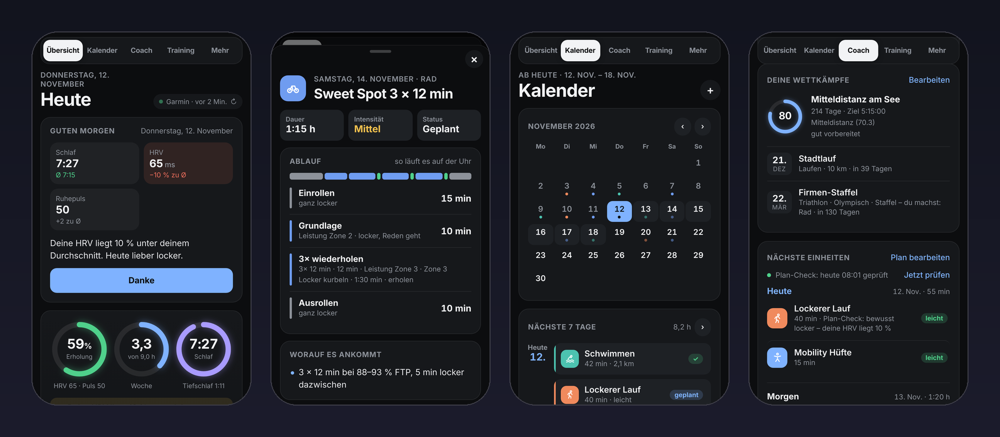
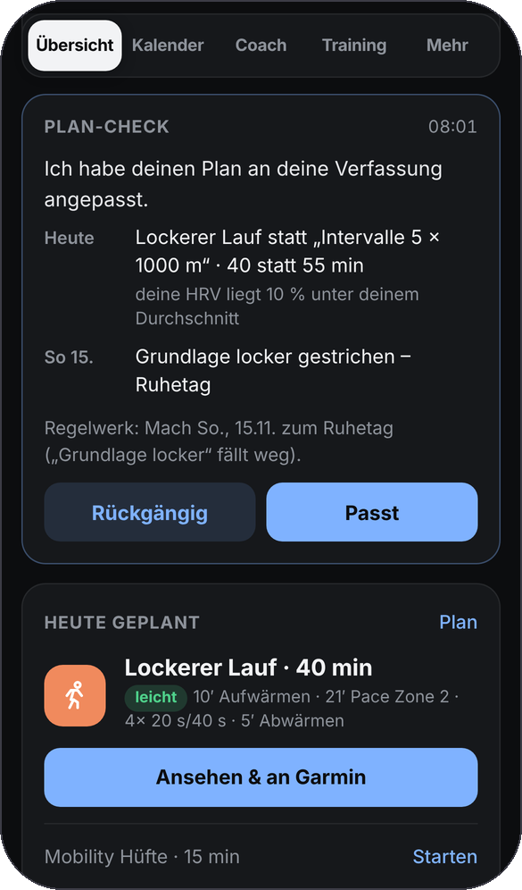
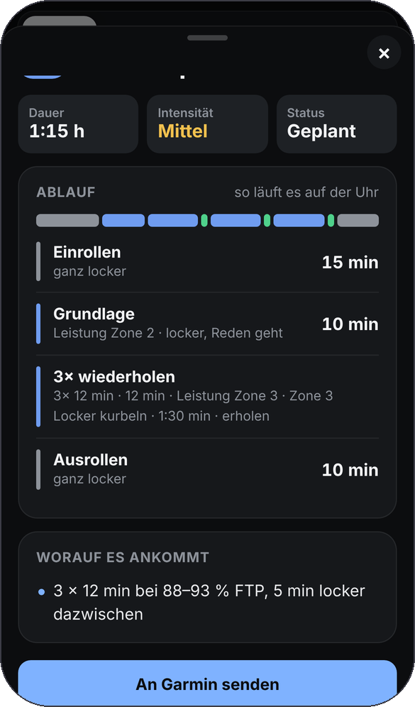
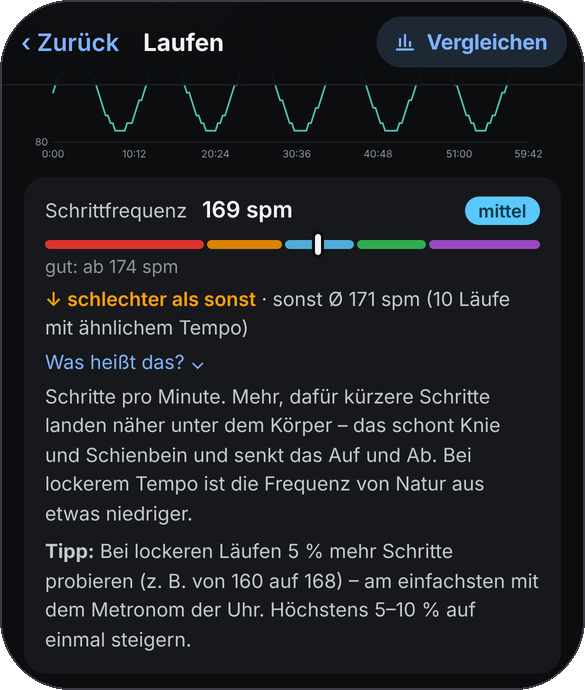
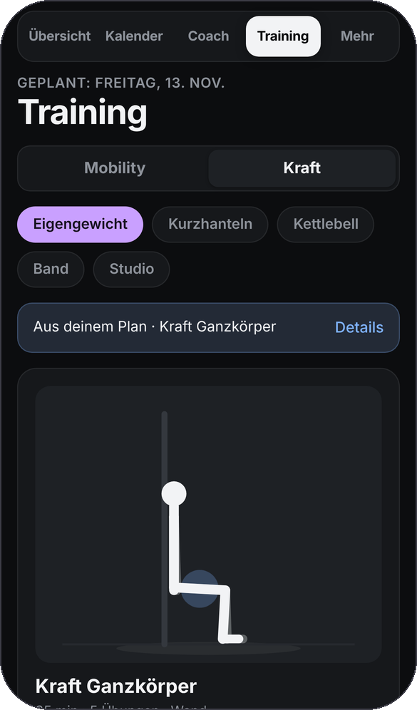
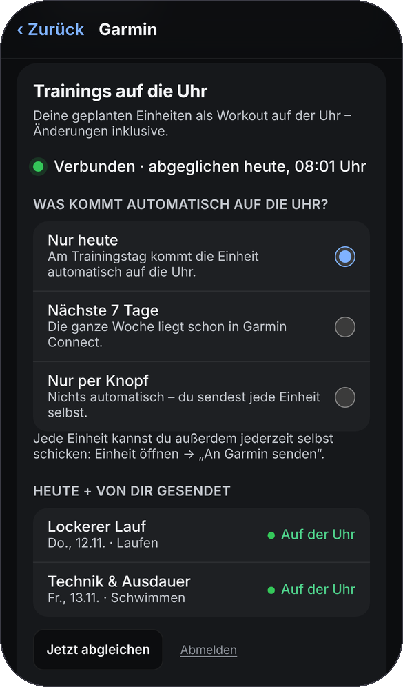
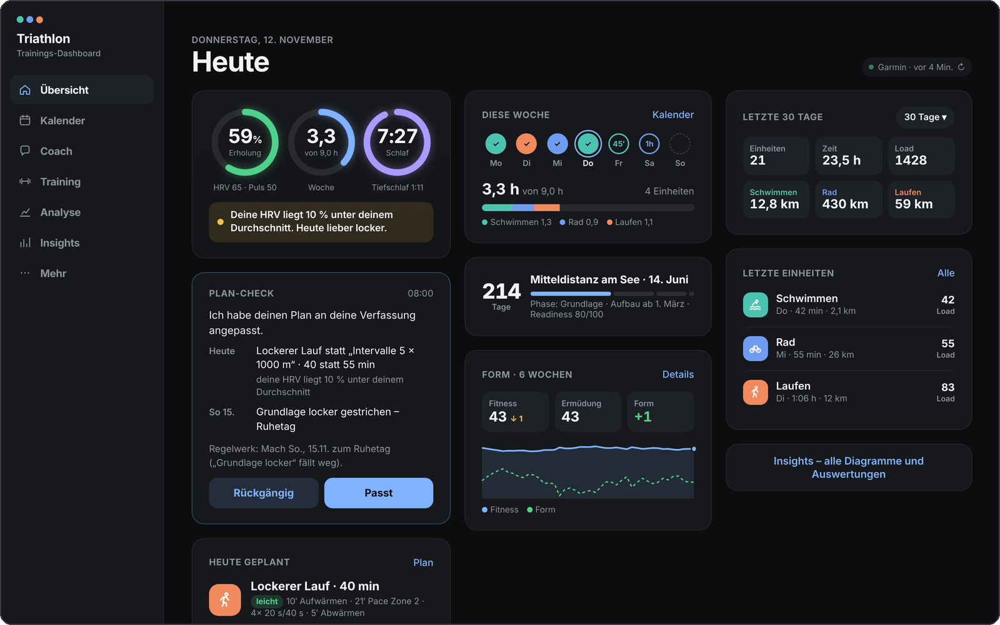
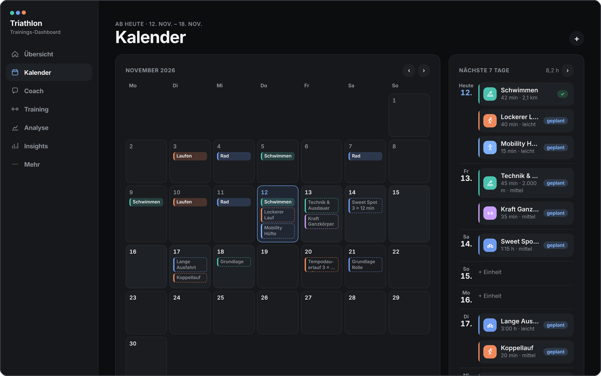
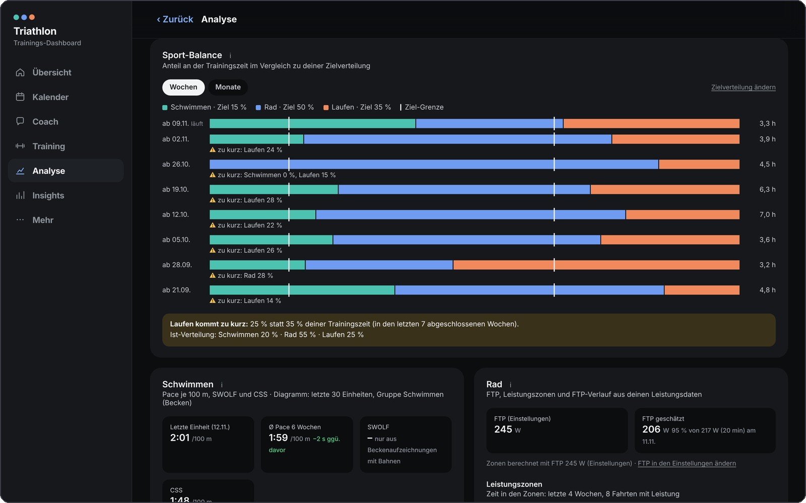
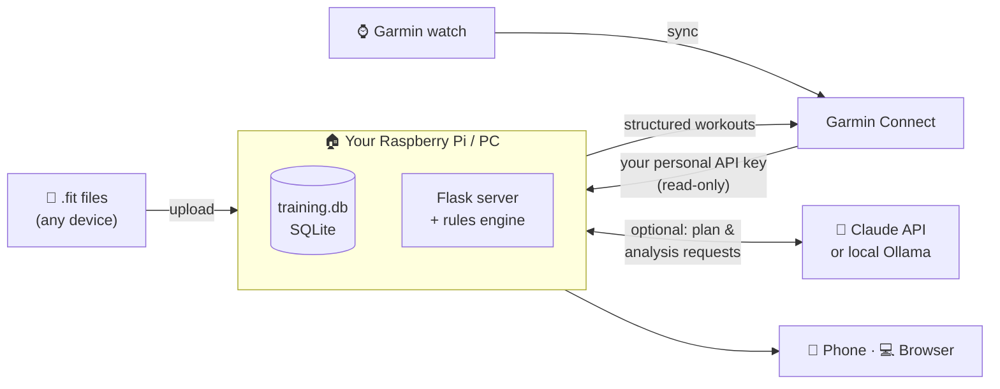

<div align="center">

# 🏊 🚴 🏃 Triathlon Training Dashboard

**Your own AI triathlon coach, training log and Garmin workout planner, self-hosted and free.**

It does what TrainingPeaks, TriDot or Garmin Connect+ do, without a subscription,<br>
and your health data never leaves your own hardware.

[](https://github.com/nico-lehr/TriathlonTrainingsDashboard/releases)


[](https://github.com/nico-lehr/TriathlonTrainingsDashboard/stargazers)

**English** · [Deutsch](README.de.md)



</div>

> [!NOTE]
> The app's interface is currently **in German**. The code, docs and this README are open to everyone, and translations are very welcome.

---

## 💸 Why this exists

Serious amateur triathletes usually end up paying for **several subscriptions at once**:

| What you need | Typical paid product | List price* |
|---|---|---|
| Training log & analytics (fitness / fatigue / form) | TrainingPeaks Premium | $134.99 / year |
| Adaptive AI training plan | Athletica · Humango · TriDot | $189 / year · ~$29 / month · tiers from $14.99 |
| Premium watch insights | Garmin Connect+ | $69.99 / year (€89.99) |
| Social / segments, optional | Strava | $79.99 / year |
| **A typical stack** (TrainingPeaks + Athletica + Connect+) | | **≈ $394 every year** |
| **This project** | **open code, runs on your own hardware** | **$0** |

<sub>* US list prices as published by the vendors or their app-store listings, checked November 2026. Prices change, taxes vary by country. All product names are trademarks of their owners; this project is not affiliated with any of them.</sub>

**The only optional running costs:**

- **AI coach:** you pay per request with your own Claude API key. That is usually a few cents per request, and the app shows the exact cost per model and per task. With [Ollama](https://ollama.com) it runs locally for **free**.
- **Hardware:** a Raspberry Pi (one-off purchase) if you want it running 24/7. Any Mac or Windows PC works too.

---

## ✨ What you get

<table>
<tr>
<td width="50%" valign="top">

### 🤖 An AI coach that actually adapts
- **Generates your whole plan** from your goal race, available days, swim days, long-session day, weekly hours and strength wishes.
- **Daily plan check:** it looks at today and tomorrow every day, the rest of the week every 3 days, and further ahead once a week. After a bad night (low HRV, high resting HR, elevated skin temperature) it **turns a hard session into an easy one** and tells you why, with a one-tap undo.
- **"Tell the coach"**: type *"spontaneously swimming 45 min today"* and it re-plans the next 7 days.
- **7 hard training rules** check every plan, from the AI or your own: no two hard days in a row, ~80 % easy, max +10 % volume per week, deload weeks, a rest day, easy after races, and more.

</td>
<td width="50%" valign="top" align="center">

</td>
</tr>
<tr>
<td width="50%" valign="top" align="center">

</td>
<td width="50%" valign="top">

### ⌚ Workouts straight to your Garmin watch
- Every planned session becomes a **structured Garmin workout**: warm-up, intervals with repeats and rests, cool-down, and target zones from *your* pace, power and heart-rate values.
- **Swims in metres**, like Garmin Coach: drills, 10 × 100 m with 20 s rest, stroke type, pool length.
- **Strength and mobility too**, with exercises, sets, reps and weights.
- You choose what lands on the watch: **only today's session** (default), **the next 7 days**, or **only when you tap "Send to Garmin"**. Moved, edited or deleted sessions are synced automatically.

</td>
</tr>
<tr>
<td width="50%" valign="top">

### 📊 "Is my value good?" for every session
- Cadence, ground contact time, vertical ratio, power, heart rate, pace, SWOLF, CSS and more, each with a **colour scale**, **better or worse than usual** (compared with your runs at a similar pace) and a plain-language **"What does this mean?" + tip**.
- **Fitness / fatigue / form** (CTL/ATL/TSB), ACWR, polarised-training split, HR zones, personal records, FTP and CSS estimates, run & bike VO2max.
- **AI analysis** of single sessions that knows what was planned that day and how you slept.

</td>
<td width="50%" valign="top" align="center">

</td>
</tr>
<tr>
<td width="50%" valign="top" align="center">

</td>
<td width="50%" valign="top">

### 🏋️ Strength & mobility built in
- **50 strength exercises** and **33 mobility exercises**, each with an animated stick figure, steps, common mistakes and easier or harder variants.
- **Follow-along mode** for your phone: big timer, side switch, "set done", and the screen stays on.
- Bodyweight, dumbbells, kettlebell, band or gym: the plan uses what you have, and it remembers your weights.

</td>
</tr>
<tr>
<td width="50%" valign="top">

### 🏁 Races, recovery & everyday life
- **Races in detail:** presets from super-sprint to Ironman, 5 km to ultra, **relays** (you do the bike, the team does the rest), terrain, target times per leg, race plan with pacing and checklists.
- **Garmin events** from your Garmin calendar show up as goals automatically.
- **Morning report** with sleep, HRV and resting HR compared with *your* baseline, plus a push notification on your phone.
- Weather on outdoor sessions, a calendar feed for Apple/Google Calendar, and gear tracking (shoe and bike mileage).

</td>
<td width="50%" valign="top" align="center">

</td>
</tr>
</table>

<details>
<summary><b>🖥️ It also works on a big screen</b> (click to expand)</summary>
<br>



</details>

---

## ⚖️ Side by side

|  | Paid cloud apps | **Triathlon Training Dashboard** |
|---|:---:|:---:|
| Yearly cost | $70–$400+ | **$0** |
| Where your health data lives | Vendor's cloud | **Your own Pi / PC** (SQLite file) |
| Can be shut down, paywalled or have its price raised | Yes | **No.** You own the code |
| AI coach that re-plans after bad sleep | Some, in higher tiers | ✅ |
| Structured workouts on your Garmin | Most | ✅ incl. swim, strength & mobility |
| Explains *why* a value is good or bad | Rarely | ✅ for every key metric |
| Friends & family on one install | Usually separate subscriptions | ✅ invite codes, each person sees only their own data |
| Choose your AI (cloud or 100 % local) | No | ✅ Claude or Ollama |
| Works on phone like an app | Yes | ✅ installable web app (PWA) with push |

---

## 🧭 How it works



- **One small server at home** serves the app to all your devices. Use [Tailscale](https://tailscale.com) or a single command for a fixed HTTPS address.
- **Everything personal stays in one SQLite file** on your machine, with automatic backups before every start and update.
- **One-click updates** from inside the dashboard, or fully automatic at night.

---

## 🚀 Quick start

**Option 1: just look around (no install).**

```bash
python3 build-demo.py      # creates dashboard-demo.html with made-up demo data
```
Double-click `dashboard-demo.html`. That's it.

**Option 2: on your Mac or PC (about 10 minutes, no coding skills needed).**

```bash
git clone https://github.com/nico-lehr/TriathlonTrainingsDashboard.git
cd TriathlonTrainingsDashboard
bash start.sh                        # Windows: double-click start.bat
python3 backend/create_user.py       # in a second terminal: create your account
```
Open **http://localhost:5000**, log in, and connect Garmin in the onboarding. It takes three steps, and **no Garmin password** is needed.

**Option 3: 24/7 on a Raspberry Pi (recommended).**

```bash
bash deploy/raspberry-pi/install.sh      # installs and starts the dashboard as a service
bash deploy/raspberry-pi/oeffentlich.sh  # optional: fixed HTTPS address from anywhere
```

📖 Detailed step-by-step guides (in German, written for beginners):
[Installation](docs/INSTALLATION.md) · [Raspberry Pi](docs/RASPBERRY_PI_ANLEITUNG.md) · [Operations & friends](docs/DEPLOYMENT.md) · [Garmin sync](docs/GARMIN_SYNC_GUIDE.md)

---

## 🔒 Privacy & security

- **Self-hosted by design.** No account with us, no tracking, no ads. Your data sits in `training.db` on your own machine.
- **Your Garmin password is never stored.** Data comes in through Garmin's official *Personal API* key, which is read-only. Tokens live outside the project folder and are readable only by your user.
- **Multi-user with strict separation.** Every request is authenticated and filtered by person. Accounts are locked after repeated failed logins, and security headers are set.
- **The server delivers only an allow-list** of app files. Database, secrets, backups and docs are never served.
- **The AI is your choice.** With Claude, only summarised metrics and your training profile are sent, and the key stays on your server, never in the browser. With Ollama nothing leaves your network.

---

## 🛠️ Under the hood

- **Frontend:** vanilla JavaScript, HTML and CSS with no framework and no build step. It includes a hand-written binary **FIT parser** (compressed timestamps, developer fields).
- **Backend:** Python 3 with Flask, SQLAlchemy, SQLite and waitress. It runs on a Raspberry Pi.
- **Sports science as pure, tested functions:** PMC (CTL/ATL/TSB), ACWR (Gabbett 2016), polarised distribution (Seiler), periodisation, plan rules, VO2max and FTP/CSS estimates.
- **Tests:** about 270 JavaScript tests (`node --test tests/js/`) and about 270 backend tests (`python -m unittest discover -s backend -t .`). The tests never call Garmin for real; they use mocks only.
- **Docs for contributors:** [Project map](docs/PROJECT_MAP.md) · [Data model](docs/DATA_MODEL.md) · [Changelog](CHANGELOG.md)

---

## ❓ FAQ

<details>
<summary><b>Do I need a Garmin watch?</b></summary>

No. You can upload `.fit` files from any device that records them. Garmin unlocks the extras: automatic sync, sleep, HRV and wellness data, events, and workouts on the watch.
</details>

<details>
<summary><b>Is it really free?</b></summary>

The software costs nothing and has no subscription. The AI coach is optional: either you pay the AI provider directly per request (usually cents, and the app shows the exact cost), or you run it locally with Ollama for free. Everything else works without AI too.
</details>

<details>
<summary><b>Do I need to be a programmer?</b></summary>

No. The guides are written for complete beginners, and installing on a Raspberry Pi takes one command. After that, updates are installed from inside the dashboard.
</details>

<details>
<summary><b>Can my friends or partner use it too?</b></summary>

Yes. Send an invite link from the settings. Everyone gets their own account, and each person only ever sees their own data.
</details>

<details>
<summary><b>How does the Garmin workout upload work?</b></summary>

Reading data uses Garmin's official Personal API. Uploading workouts to your watch uses a one-time Garmin login whose token is stored on your server, and the password itself is never stored. Support for Garmin's official Training API is prepared and will be switched on once access is available.
</details>

---

## 🤝 Contributing

Ideas, bug reports and pull requests are welcome! Good first contributions:

- 🌍 **Translating the UI** (English first)
- ⌚ Support for other watch platforms (COROS, Wahoo, Suunto, Polar)
- 🧪 More tests and real-world FIT files for the parser

Please open an issue before larger changes so we can agree on the approach. If this project saves you a subscription, **leave a ⭐**. It helps other athletes find it.

---

## ⚠️ Disclaimer

This is a hobby project, not a medical product. The sports-science metrics are estimates. Listen to your body, and if in doubt, ask a doctor or a qualified coach. Not affiliated with or endorsed by Garmin, TrainingPeaks, TriDot, Humango, Athletica, Strava or Anthropic.

## 📄 License

No open-source license has been chosen yet, so for now all rights are reserved by the author. Reading the code and running it privately for yourself is what the project is shared for. If you'd like to reuse or redistribute it, please open an issue.
